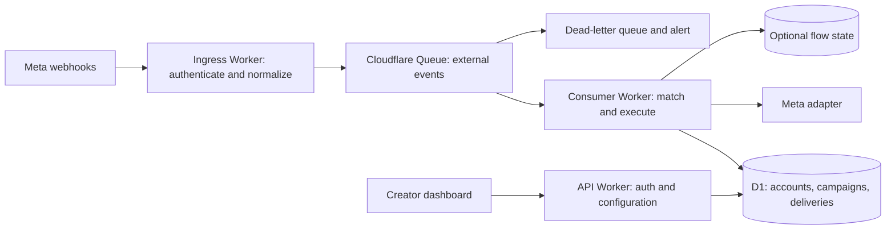

# FadeLoop V2: product idea and architecture proposal

Research date: 29 October 2026. Status: proposed design, before implementation.

Live development status and phase gates are maintained in the [implementation tracker](../implementation/implementation-plan.md). All phases follow the [Free-tier guardrails and anti-patterns](../engineering/guardrails-and-anti-patterns.md). The deployment requirement is Cloudflare Workers Free: prefer under 5 ms active CPU per invocation and remain below the 10 ms project ceiling; additional stages require measured justification and safe durable handoffs.

## 1. Product direction

FadeLoop turns an Instagram comment into a useful private reply. A creator connects an Instagram professional account, chooses a post or Reel, configures keywords, and supplies a message containing a link, coupon, or resource.

The default experience is **comment → receive the promised resource**. An opening “Send me” interaction is optional. Follow checks and email collection are separate advanced modes that create conversation state only when needed.

Start with one workspace and one connected account in the interface. Include workspace and account boundaries in storage and authorization from the beginning. This supports a self-hosted first release and leaves a path to a hosted product without building billing, teams, or a general workflow builder now.

Working assumption: Cloudflare remains the deployment platform, following the supplied research report. Whether the commercial product is self-hosted or hosted remains a product decision; public onboarding has different Meta review requirements.

## 2. What the research establishes

The local, Git-ignored `docs/research/deep-research-report.md` is the main performance investigation. Its production usage figures are reported observations, not measurements independently reproduced here.

The public repository describes a self-hosted creator tool with optional follow and email flows. It provides useful integration behavior, but V2 should establish its own execution model. [Old project](https://github.com/arshadakl/FadeLoop)

Three inspected source paths support the report's concerns:

- Configuration schedules a minute trigger and a daily token refresh. [Wrangler configuration](https://github.com/arshadakl/FadeLoop/blob/main/wrangler.toml)
- Webhook handling reads connection generation before authenticating the body; task mode persists an envelope and publishes a task notification. [Webhook route](https://github.com/arshadakl/FadeLoop/blob/main/src/routes/webhook.ts)
- The consumer reconstructs runtime, claims a database task, executes a task kind, settles it, and publishes more work; extra batch messages are retried. [Task consumer](https://github.com/arshadakl/FadeLoop/blob/main/src/tasks/consumer.ts)

These are architectural amplification points. Their exact contribution to production costs still needs telemetry. Reuse provider knowledge and verified fixtures from V1, rather than importing the scheduler and database task lifecycle.

Research limitations: shell network access prevented cloning the repository; selected files were inspected through the web. Several Meta documentation pages returned access errors or HTTP 429. Meta's official Postman collection was accessible. This is an initial architecture review, not an exhaustive source audit or completed provider-contract verification.

## 3. Meta integration boundary

Prefer **Instagram API with Instagram Login** for the first implementation. Keep Facebook Login outside the first release rather than mixing token types, permissions, and hosts.

Meta's official collection supports professional business and creator accounts and documents `instagram_business_basic`, `instagram_business_manage_comments`, and `instagram_business_manage_messages`. Request only permissions used by the product; content publishing is unnecessary for the initial feature. [Meta's Instagram collection](https://www.postman.com/meta/instagram/documentation/6yqw8pt/instagram-api?entity=request-23987686-3fe78620-2258-44b6-893f-42d76c7200d7)

Build a small provider adapter with these operations:

| Operation | Purpose |
|---|---|
| OAuth authorization and code exchange | Connect the creator, validate server-bound state, resolve account identity |
| Token exchange/refresh | Store encrypted credentials and expiry metadata; refresh due accounts in bounded daily work |
| List media | Let the creator choose owned posts/Reels; paginate on demand |
| Subscribe and inspect subscriptions | Request account-level webhook fields and report actual subscription health |
| Send private reply | Address the triggering comment, not an assumed messaging recipient ID |
| Send conversation message | Address a messaging-scoped user only when a permitted interaction/window exists |
| Reply publicly to comment | Optional action with an independent delivery record |

Meta's collection shows messaging requests under `https://graph.instagram.com/{api_version}/{ig_user_id}/messages`. Pin a supported version explicitly; select it during the provider spike rather than assuming an old example version remains suitable. [Official request examples](https://www.postman.com/meta/instagram/documentation/6yqw8pt/instagram-api?entity=request-23987686-af579d08-121e-4897-8f45-5fd41ace49df)

The report describes the private-reply contract as one message per comment within seven days, with further automation requiring a qualifying user response and the applicable messaging window. Treat those as **release-critical contracts to reverify** against Meta's private-reply documentation and real test accounts before sending. Ordinary messaging requires the recipient to have contacted the professional account. An outgoing private reply or a URL-button click must not automatically grant follow-up permission. [Meta messaging prerequisites](https://www.postman.com/meta/instagram/documentation/6yqw8pt/instagram-api?entity=request-23987686-10bf8bf7-d9b7-4340-9c66-61d3ce683a87)

Do not promise follow gating until the selected login path's profile fields, identity requirements, and access eligibility are proven. An unavailable relationship lookup is “unknown,” not “not following.” Do not use scraping as a fallback.

Public onboarding also needs a verified app-access matrix: required permissions, Standard versus Advanced Access, review/business verification requirements, privacy policy, deauthorization and deletion handling. Test-account success alone does not establish readiness for external customers.

## 4. Webhook contract

Maintain separate GET verification and POST event handlers. The old integration demonstrates challenge verification, raw-body signature verification, and distinct app/account subscription configuration; preserve these concepts through independently verified adapter tests. [Existing integration reference](https://github.com/arshadakl/FadeLoop/blob/main/src/routes/webhook.ts)

POST processing:

1. Read a bounded raw body and authenticate its HMAC signature before database access or business processing. Configure the correct signing secret for the selected Meta app setup.
2. Parse and validate the envelope, iterating every entry and supported nested event.
3. Normalize supported actionable events into a compact versioned format. Preserve source timestamps and IDs as strings.
4. Await successful Queue publication before returning success. Queue failure returns a retryable response. Do not rely on background publication after acknowledging Meta.
5. Return success without scheduling unsupported, echo, read-receipt, or other intentionally ignored events. Log malformed authenticated payloads in sanitized form with an alert path.

Expected envelope families to verify with captured fixtures:

```text
object: instagram
entry[]
  id: connected account identifier
  changes[]
    field: comments
    value: comment identity, media identity, actor, text
  messaging[]
    sender / recipient / timestamp
    message: message identity, text, optional quick_reply payload
    OR postback: payload and available provider identity
```

This is a structural sketch, not a complete payload schema. Comment changes and messaging events need different parsers. Comment actors, account IDs, and messaging-scoped recipient IDs must not be treated as interchangeable without a documented mapping.

Proposed internal event:

```ts
type AutomationEvent = {
  schemaVersion: 1;
  kind: 'comment.created' | 'message.received' | 'postback.received';
  accountId: string;
  providerEventKey: string;
  occurredAt: number; // normalized epoch milliseconds
  receivedAt: number;
  mediaId?: string;
  commentId?: string;
  messagingUserId?: string;
  text?: string;
  interactionPayload?: string;
};
```

The consumer resolves the trusted workspace/account relationship from storage. Do not accept a tenant identity supplied by an external payload or browser. Prefer provider event IDs; define and test a deterministic composite key where an event has no standalone ID.

Publishing a multi-event envelope can partially succeed. A later Meta retry can repeat already-published events, so downstream deduplication remains required. Bound body size, event count, and Queue batch chunks; monitor oversized legitimate envelopes rather than silently discarding them.

## 5. Execution architecture



Use three deployment entry points in one TypeScript repository. They are narrow runtime boundaries, not an invitation to build a large microservice system. The dashboard uses React, Vite, TypeScript, Tailwind CSS, shadcn/ui, and TanStack Query. The ingress bundle should not import UI authentication, reporting, or a generic workflow engine. Sections 10–12 define frontend, design, and Worker code standards.

Queues carries the actual normalized event. D1 stores configuration, delivery outcomes, and required conversation state. There is no normal `work_tasks` table, per-minute discovery loop, or automatic comment polling.

Start with batch size one for profiling and per-message acknowledgment. Increase batching only after measurements show room. Queues is at-least-once and does not guarantee event order, so duplicate protection and explicit flow concurrency rules are required. [Delivery guarantees](https://developers.cloudflare.com/queues/reference/delivery-guarantees/), [Queue behavior](https://developers.cloudflare.com/queues/reference/how-queues-works/)

“Idle costs approach zero” applies to automation processing. Owner dashboard requests, token maintenance, retention, and monitoring remain legitimate activity.

## 6. Campaign matching and data

First release: selected post/Reel, any-comment or keyword trigger, direct text/link delivery, optional public acknowledgment, pause/resume, and a delivery activity screen. Use deterministic Unicode-aware matching with documented exact-word versus contains behavior.

Permit one published campaign per selected media in the first release. Enforce that constraint in storage. Later, multiple rules need explicit priority and one winning private reply per comment; an unordered `LIMIT 1` is insufficient.

| Entity | Responsibility |
|---|---|
| workspaces and membership | Owner authorization and future tenant boundary |
| instagram_accounts | Workspace ownership, provider identity, encrypted token, expiry, connection status |
| campaigns and published revisions | Media targeting, compiled match/message config, active status |
| deliveries | Stable action key, campaign revision, outcome, provider response identity, sanitized failure |
| flow_sessions, later | Current optional flow, messaging identity, step/version, expiry, interaction correlation |
| contacts, later | Attributes actually collected or required by a flow |

Design indexes around exact account/media lookup and bounded activity pagination. Check `EXPLAIN QUERY PLAN` and D1 row metadata on realistically sized fixtures. Avoid reading whole histories to determine the next action.

At first processing, bind a matched delivery to an immutable campaign revision. Retrying must not switch its content after a campaign edit. Before external execution, check current account connection and campaign pause status; pausing cancels unsent work under the proposed product semantics.

A private-reply action key should be scoped to **account + comment + private-reply action**, independent of campaign revision. Including a revision or campaign in that uniqueness boundary could allow a duplicate after an edit or overlapping match. A public acknowledgment uses a separate action key.

Retain deduplication records across the entire supported provider/Queue/manual replay horizon. Expired events remain ineligible even after older records are purged.

## 7. Sending, retries, and concurrency

A unique insert alone is insufficient: it prevents competing inserts but does not explain whether an interrupted attempt actually reached Meta.

Use an atomic claim with owner/attempt token and explicit outcomes:

```text
reserved → sending → sent
                  → retryable (documented safe rejection)
                  → failed (permanent rejection)
                  → unknown (external acceptance uncertain)
```

Only the successful claim owner may call Meta. A repeated delivery already marked sent is acknowledged without sending. A duplicate seeing an active claim waits/retries. A stale `sending` attempt becomes unknown rather than being blindly reclaimed for another send.

Crash before calling Meta after recording `sending` and crash after Meta acceptance can be indistinguishable. The proposal favors avoiding duplicates: unknown results need provider-supported reconciliation or operator review, accepting that some messages may remain undelivered. Exactly-once external delivery cannot be promised without an applicable provider idempotency mechanism.

Classify failures from documented Meta error codes/subcodes as well as HTTP status. Authentication revocation pauses the account; malformed requests fail permanently; throttling receives a bounded delayed retry; timeouts and ambiguous server errors do not automatically mean safe resend. Honor provider retry information when available. Limit attempts and total age, and reject work outside policy windows.

DLQ messages need an alert and an operator recovery path before retention expires. Free Queues retention is 24 hours; messages can expire, including when an outage prevents normal processing. A DLQ is not an indefinite archive. [Queue limits](https://developers.cloudflare.com/queues/platform/limits/)

Do not implement rate limiting with separate read-then-update counters under concurrent consumers. Use an atomic conditional reservation in D1 for a basic bounded gate, or a per-account Durable Object when strict pacing is required. Never one global coordinator. Define rates from verified operation-specific limits and observed provider responses, not a guessed universal daily allowance.

For advanced flows, a button payload must correlate to the account, messaging user, flow session, expected step, and expiry. Use opaque unguessable references or authenticated payloads. Compare-and-set the flow version to reject duplicate/stale transitions. Batch size one does not serialize all account activity.

## 8. Changes to the supplied report's plan

- Keep the event-driven model and optional direct delivery.
- Treat CPU and row budgets as profiling targets, not established performance guarantees.
- Expand the proposed delivery states to represent uncertain sends and safe retries.
- Add atomic ownership for sends, counters, and flow transitions.
- Add deterministic campaign conflict rules and revision binding.
- Handle partial envelope publication and delayed/out-of-order events explicitly.
- Make follow-gate availability a verified capability, not an assumed core feature.
- Avoid adding KV initially. It is unnecessary for the first indexed lookup and unsuitable as authoritative deduplication state.
- Keep the free tier as a prototype constraint, not a product promise. Workers Free has a tight HTTP CPU limit; waiting on network I/O is distinct from CPU execution. [Worker limits](https://developers.cloudflare.com/workers/platform/limits/)

## 9. Build order and proof

1. **Provider spike:** authorize a test professional account; verify token lifecycle, actual account/app subscriptions, signed comment/message/postback fixtures, direct private reply, and permitted continuation. Record permissions, supported API version, errors, and identity mapping. Resolve blocked Meta documentation contracts here.
2. **Direct vertical slice:** one account, one campaign, verified ingress, Queue consumer, atomic delivery handling, real private reply, and readable failure activity.
3. **Reliability gate:** duplicate webhook/Queue messages, simultaneous claims, partial publish, disconnected account, campaign pause/edit, expired event, throttling, and crash points before/after the Meta call. Demonstrate unknown outcomes without automatic duplicate sends.
4. **Creator interface:** connect health, paginated media picker, campaign editor, preview, pause, and delivery list. Include owner authentication and workspace-scoped access on every API operation.
5. **Advanced flows:** tap-to-continue first, then email collection, then follow gating only after verified API eligibility. Avoid a visual flow builder until repeated user needs justify one.
6. **Scale validation:** burst testing per account and across accounts, Queue age, provider throttling, D1 row counts, CPU profiles, and bounded reporting queries. Introduce account coordination or database partitioning only when evidence requires them.

Measure ingress/consumer CPU separately, rows read/written per event, Queue age/retries, Meta error families, sent/failed/unknown outcomes, and idle automation activity. Logs exclude credentials, complete comments, email contents, and raw webhook bodies by default.

Provisional direct-path budgets from the report: ingress p95 below 5 ms CPU, consumer p95 below 8 ms CPU, and roughly ten metered D1 reads/writes each per event. Token lookup, index maintenance, atomic claims, and any rate gate must be counted; do not remove correctness to hit an arbitrary number.

The first release is complete when a creator can connect, publish a keyword campaign, receive the promised resource from a real comment, understand failed/uncertain deliveries, and pause automation—with duplicate and crash behavior demonstrated. No implementation or deployment has been performed as part of this proposal.

## 10. Frontend stack and organization

These are agreed planning choices. Adapt useful patterns from the supplied X-Client and API-folder guides to a React application; their Next.js runtime and ELT-specific design system do not apply.

| Concern | Choice |
|---|---|
| Application | React + Vite + strict TypeScript |
| Styling | Tailwind CSS with centralized semantic CSS tokens |
| UI | shadcn/ui primitives, customized through shared components and tokens |
| Server state | TanStack Query |
| Owner authentication | Supabase Auth email/password with revocable HttpOnly D1 sessions; see [authentication decision](../engineering/owner-authentication.md) |
| Forms | React Hook Form + Zod for form validation |
| UI state | Local React state; Context only for genuinely shared client state |
| Navigation state | URL parameters for shareable filters, search, and pagination |
| Package management | pnpm with a single committed lockfile |
| Quality tools | Biome for formatting/linting, TypeScript checks, Vitest for behavior |

Select compatible dependency versions during scaffolding. Add a client router appropriate to the actual page structure then. Storybook is optional for a growing shared component library; it is not required for every component or the first vertical slice.

Proposed repository structure (create folders when they have real contents):

```text
apps/
  web/src/
    app/                       # Providers, router, application shell
    pages/                     # Thin page composition
    features/
      campaigns/
        api/
          campaign.types.ts
          campaign-keys.ts
          campaign-queries.ts
          campaign-mutations.ts
        hooks/
        components/
        validators/
      accounts/
      deliveries/
    components/
      ui/                      # shadcn/ui primitives
      common/                  # Reused UI: empty states, status badges, confirmations
      layout/                  # Shared navigation and page layout
    api/                       # Shared transport, API errors, session handling
    hooks/common/              # General hooks used across features
    lib/                       # Small focused utilities such as cn()
    styles/                    # Tokens, typography, global styles
  api/src/                     # Dashboard API Worker
    routes/
    features/                  # Feature services and focused D1 access modules
    common/                    # Shared HTTP errors, auth helpers, request context
  ingress/src/                 # Signature verification, parsing, enqueueing
  consumer/src/                # Matching and delivery orchestration
packages/
  contracts/src/               # Browser-safe request/response and event schemas
  domain/src/                  # Pure matching, eligibility, and delivery rules
  worker-common/src/           # Shared Worker-only DB, Meta, logging, crypto helpers
schema/                        # Versioned D1 migrations
```

Feature-specific code stays with its feature. Move something into `common/` when multiple consumers need the same behavior, and give it one clear owner. Keep browser-safe contracts separate from Worker-only credentials, bindings, and provider code. Shared packages need narrow imports so ingress does not load unrelated modules.

### API and TanStack Query standards

- Centralize base URL, session transport, response parsing, cancellation, and normalized `APIError` handling in `web/src/api/`. Components do not call `fetch` or construct authentication headers independently.
- Keep feature read operations, mutations, types, and query keys together, following the supplied API-folder guide. Prefer small typed functions; introduce client classes only if they solve a demonstrated need. A `ResourceClient` inheritance hierarchy is not required.
- Define request/response contracts once in the browser-safe contracts package. Infer types from runtime schemas. If OpenAPI generation is introduced, generate schema types rather than maintaining a second handwritten copy. Do not manually edit generated files.
- Return the documented response shape. Avoid fallback expressions such as `data.entity || data`, which hide contract mismatches.
- Query keys include workspace, account, resource ID, and all relevant filters/cursors. Keys for one account must never reuse another account's cached results.
- Queries run only once required session and scope identifiers are available. Pass the query cancellation signal to the transport. Feature hooks compose query options and mutations; visual components consume their state.
- Use explicit freshness/refetch policies. Avoid background polling of every dashboard resource; any activity refresh is bounded, visible-page driven, and justified by product needs.
- Mutations invalidate or update the affected scoped list/detail keys. Await required invalidation when completion depends on refreshed data. Do not invalidate the entire application cache after each change.
- Set retry policies deliberately: bounded retries for suitable reads, no retries for authorization/validation failures, and no automatic retry of a potentially accepted write without an idempotency contract. UI mutation retries are separate from Queue delivery retries.
- Clear scoped cache on logout/account removal and isolate account switching. Keep Meta access tokens entirely on the server. Prefer a same-origin secure HttpOnly session cookie with appropriate CSRF protection; do not inherit browser bearer-token storage from the Next.js examples by default.
- Treat pending, empty, error, success, and background-refresh states explicitly. Show contextual errors near the action and provide a useful recovery action. Reserve optimistic updates for reversible, well-understood edits with rollback; do not optimistically report an external DM as sent.

## 11. Design standard

Use [design-SKILL.md](../design/design-SKILL.md) as the visual reference: a restrained Notion-inspired light interface, Inter typography, clear hierarchy, subtle borders, and a limited palette. The following adaptations resolve contradictions and extraction artifacts in that reference for FadeLoop.

| Area | FadeLoop standard |
|---|---|
| Tokens | Define the reference palette once as CSS variables and expose semantic Tailwind utilities. Map shadcn background, foreground, primary, border, ring, and muted tokens to that system. No inline hex colors or scattered primitive overrides in feature components. |
| Palette | Preserve `surface-base: #F6F6F6` and `accent: #97CAEE`. Define hover, disabled, semantic status, and foreground pairings centrally. Accent is a background/highlight, not automatically accessible text on a light surface. |
| Contrast | Verify normal text contrast of at least 4.5:1. Choose contrasting button text and accessible focus indicators; if the pale accent alone is insufficient, pair it with a contrasting indicator. Status must not rely on color alone. |
| Typography | Use Inter, a 16px/500 body baseline, balanced headings, pretty body wrapping, and tabular numbers for metrics. Reserve the reference's 66px/700 display heading for spacious hero contexts; use a responsive smaller scale for dashboard headings. Preserve default letter spacing. |
| Spacing | Use a consistent 4px layout grid through named spacing tokens. The reference's irregular detected measurements and default 1px gap are not general layout rules. Borders may remain 1px. |
| Shape | Use the reference's 3px, 4px, 6px, and 15px radius tokens, with 4px as the default and consistent 1px borders. |
| Responsive layout | Design mobile-first and verify through the reference's 1920px desktop viewport. Fixed 1920px layouts and detected tiny content widths are not requirements. Use `dvh` for viewport-height layouts and safe-area insets for fixed controls. |
| Inputs | Use visible, padded, usable inputs with labels and suitable interaction targets. The reference's `0px` input height is an extraction error and must not be implemented. |
| Interaction | Preserve keyboard navigation, visible focus with 2px outline/offset, accessible icon labels, paste support, contextual validation, and destructive-action AlertDialogs. Disabled controls expose their state programmatically as well as visually. |
| Loading | Prefer structural skeletons, distinguish empty data from loading, and preserve useful existing content during refresh. |
| Motion | No decorative animation by default. When requested, use brief transform/opacity motion, at most 200ms for feedback, and respect reduced motion. Avoid layout animation, large animated blur, and idle `will-change`. |

Use the `cn()` utility for conditional class composition and shared component variants for repeated appearances. Put reusable business presentation in `components/common/`; keep product-specific behavior in feature components. Do not copy the ELT/Triple I/Westmount brand tokens or multi-brand system into FadeLoop.

Before approving a screen, verify mobile and desktop layout, keyboard flow, focus visibility, contrast, labels, overflow, and pending/empty/error states. Use the same tokens and shared primitives for every screen.

## 12. Code standards and quality gates

### Standards shared by frontend and Workers

- Enable strict TypeScript. Use `unknown` plus narrowing for untrusted data; avoid `any`, unchecked casts, and non-null assertions used to suppress missing-state handling. Use discriminated unions for event kinds and delivery outcomes so required fields are enforced per variant; the section 4 event shape is illustrative and should be tightened during implementation.
- Use kebab-case files/directories, PascalCase components/types, camelCase functions/variables, and meaningful boolean prefixes such as `is`, `has`, `can`, and `should`. Prefer `.types.ts` for module types; reserve declaration files for generated or ambient declarations.
- Keep functions and modules focused on one responsibility. Split large components by coherent UI sections and behavior; split services at domain and I/O boundaries. Avoid arbitrary file-size rules and one-function wrappers that only add navigation overhead.
- Check for existing helpers/components before adding new ones. Share repeated rules, transport, parsing, and presentation through their owning common module. Extract real duplication without turning unrelated features into a generic configurable framework.
- Prefer named exports for reusable modules, explicit public contracts, early returns, and readable control flow. Comments explain policy, invariants, or tradeoffs rather than narrating syntax.
- Handle expected errors explicitly; preserve causal details in sanitized server logs and return safe typed errors to callers. Never swallow exceptions or report success before required persistence/external work is confirmed.
- Keep constants and validation rules near their owning feature; promote them only when shared. No unexplained numeric thresholds or duplicated status-string definitions.
- Avoid unnecessary dependencies, premature memoization, and broad barrel exports that hide dependency boundaries. Commit dependency/lockfile changes together.

### Frontend implementation rules

- Pages compose feature components; they do not combine transport, form validation, and large UI trees in one file. Shared primitives have typed props and accessible defaults.
- Use TanStack Query for remote state, React Hook Form for forms, and local state for transient UI. Derive values during render instead of copying them into state through effects. Use effects for external synchronization with cleanup.
- Split bundles at meaningful page/feature boundaries using lazy imports. Load heavy optional tools only when opened. Do not fragment every button into a separately loaded chunk.
- Keep form schemas near the feature, share applicable contract constraints, and validate again on the Worker. Present field errors inline and submission errors at the form/action.
- Do not import Next.js App Router, Server Components, `use client`, Next-specific server API clients, or Next-specific authorization helpers. Use the React router and API error boundaries selected for this application.

### Worker implementation rules

- Keep entry points thin: validate configuration/context, route the request or Queue batch, invoke the responsible function, and format the result. Separate HTTP transport, pure business rules, D1 queries, and Meta calls.
- Type Worker bindings and validate required configuration clearly. Validate HTTP, OAuth, webhook, and Queue inputs at their trust boundaries; internal types alone do not validate runtime input.
- Keep raw-body HMAC verification ahead of webhook parsing/business access. Share cryptographic helpers only within Worker code. Secrets remain in Worker secret bindings or encrypted storage and never enter browser bundles or logs.
- Centralize parameterized D1 queries in focused access modules. Enforce workspace/account ownership in scoped reads and writes, use indexed bounded access, and implement claims/state changes atomically. Keep schema changes in reviewed migrations.
- Give the Meta adapter one implementation of request construction, timeout handling, error classification, and sanitized observability. The caller decides business retry policy; avoid overlapping retries in both adapter and Queue consumer.
- Bound body sizes, result sets, batch sizes, concurrency, retries, and execution age. Explicitly acknowledge/retry each Queue message. Avoid unawaited critical promises and uncontrolled `Promise.all` over external sends.
- Inject clock/provider/storage seams where they make policy and crash behavior testable. Pure domain code must not import Worker globals, React, or provider credentials.
- Share required behavior through narrow `worker-common` modules while preserving the small ingress dependency graph. Keep frontend session authorization separate from webhook authentication and consumer execution.

### Required verification

Before merging implementation changes, run formatting/linting, strict type checks across affected apps/packages, relevant behavior tests, and production builds for the affected frontend/Worker bundles. CI should enforce these commands consistently.

Prioritize tests for campaign matching, schema validation, tenant authorization, query cache isolation, form behavior, webhook fixtures, duplicate/concurrent delivery claims, retry classification, and ambiguous-send outcomes. Exercise Worker integration paths using a suitable local Cloudflare runtime and verify provider contracts with controlled test accounts. Avoid tests that merely reproduce implementation details.

For UI changes, include focused interaction/accessibility checks and visual review at representative mobile/desktop widths. For hot Worker changes, include CPU/D1 access evidence against the existing budgets. Keep tests beside the feature/module they cover, with shared fixtures in a clearly owned test support folder. Storybook can document reusable visual variants when it adds value.

These standards govern the future implementation. This update records stack, organization, design adaptations, and quality expectations; it does not scaffold code or install dependencies.

## 13. Git branches, pushes, and commit messages

All development and commits take place on **`dev`**, and all pushes target **remote `dev` only**. Do not create feature branches or push to `main`, `master`, other branches, or tags unless the user explicitly revises this policy. Verify the branch before editing and committing, review the staged diff, and run the checks appropriate to the change.

Every commit follows [Conventional Commits 1.0.0](https://www.conventionalcommits.org/en/v1.0.0/):

```text
<type>[optional scope][optional !]: <description>

[optional body]

[optional footer(s)]
```

Use `feat` for new features, `fix` for bug fixes, and appropriate types such as `docs`, `refactor`, `perf`, `test`, `build`, `ci`, and `chore` for other changes. Use consistent lowercase types and optional scopes such as `web`, `api`, `ingress`, `consumer`, or `contracts`. Mark breaking changes with `!` before the colon or an uppercase `BREAKING CHANGE:` footer, explaining the impact when needed.

Examples:

```text
feat(web): add campaign editor
fix(consumer): prevent concurrent private replies
docs: record development workflow
```

Once the V2 remote is identified and configured, push explicitly with `git push origin dev:dev`. Do not use broad push options (`--all`, `--mirror`) or force pushes. The old FadeLoop repository is a reference, not an assumed destination for this new project.

Repository-level agent instructions in `AGENTS.md` preserve these requirements across future sessions. During scaffolding, add commit-message validation and a local pre-push branch guard, with CI validating commit messages independently; these enforcement tools are planned, not installed yet.
